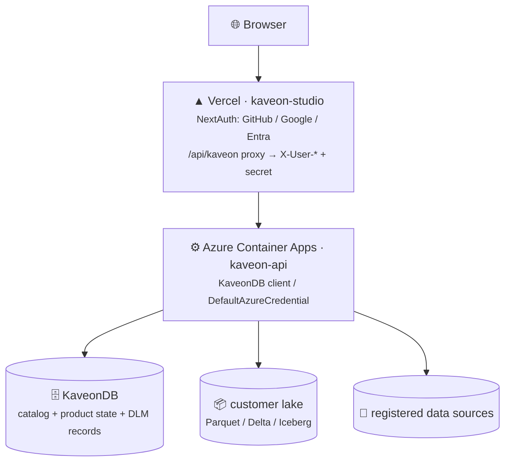

# Kaveon — Deployment Guide

> **Stack:** Vercel (kaveon-studio) + Azure Container Apps (kaveon-api) + KaveonDB (native catalog, transaction log, and product state)
> **Live:** [kaveon.io](https://kaveon.io)

---

## Shipping Studio + API deployment



Vercel hosts the Next.js frontend. Azure Container Apps hosts the FastAPI backend. KaveonDB owns the catalog, product state, DLM definitions/runs, query records, and transactional metadata; analytical data remains in customer-controlled Parquet/Delta/Iceberg storage and is read by the Engine. Registered external SQL sources are optional passthrough connectors, not hidden application dependencies. IaC lives in `infra/bicep/`.

## Full Walkthrough

See **[docs/guides/deploy-vercel-azure-postgres.md](docs/guides/deploy-vercel-azure-postgres.md)** for the historical PostgreSQL migration profile. For a native deployment, use the checked-in IaC under `infra/bicep/` and the [local-stack guide](docs/guides/local-stack.md); the legacy guide must not be used to provision a runtime authority.

1. **KaveonDB and lake storage** — configure the native catalog and customer-owned Parquet/Delta/Iceberg roots
2. **Azure Container Registry** — build and push the API and Engine images
3. **Azure Container Apps** — deploy kaveon-api and the Engine bridge via Bicep
4. **Vercel** — deploy kaveon-studio and configure OAuth/provider env vars
5. **Wire together** — configure callback URLs, proxy identity, allowed origins, and secrets
6. **Verify** — sign in, inspect the catalog, run SQL, and build a chart

The checked-in automation is split across two workflows: `.github/workflows/deploy.yml`
builds and deploys the API on pushes to `dev`, while `.github/workflows/ci.yml` deploys
Studio to Vercel after its web job on pushes to `dev`. Both depend on repository secrets;
see [configuration reference](docs/reference/configuration.md).

## Auth Flow

The recommended production path sends browser traffic through Vercel. `kaveon-studio`'s `/api/kaveon/*` route reads the NextAuth session server-side and forwards `X-User-*` headers to the Container App, stamped with `KAVEON_PROXY_SECRET`. See [SECURITY.md](SECURITY.md) for provider bearer-token access, the explicitly configured development-only identity bypass, and current hardening gaps. Kaveon has no local-password authentication.

## Engine deployment

`engine/docker-compose.yml` starts one coordinator and two workers against a shared local volume. It validates packaging, node discovery, heartbeats, stage scheduling, Arrow exchange/shuffle, bounded retries, and node-local Parquet/Delta queries. Populate the shared data volume before starting the stack; the repository does not ship production data. Production deployments must add the configured Engine authentication/TLS boundary and durable customer storage.

```bash
cd engine
docker compose up --build
```

See [ARCHITECTURE.md](ARCHITECTURE.md#delivery-topology) for current-versus-target behavior.

## Operational gaps

- The Container App Bicep module enables public ingress. Restrict ingress to the
  trusted Studio/proxy path before treating the topology as hardened production.
- Legacy SQL connector infrastructure, if enabled for a migration, must be
  isolated from the native KaveonDB authority and removed after reconciliation.
- The deployment does not provision Redis. Without `REDIS_URL`, rate limiting and
  query/job state are process-local and do not coordinate across replicas.
- Engine execution state is separate from KaveonDB product state; query cancellation
  is propagated through the Engine bridge, while durable product/query records are
  committed by the API in KaveonDB.

---

*See also: [ARCHITECTURE.md](ARCHITECTURE.md) · [API reference](docs/reference/api.md) · [configuration reference](docs/reference/configuration.md) · [infra/bicep/](infra/bicep/) · [studio/vercel.json](studio/vercel.json)*
