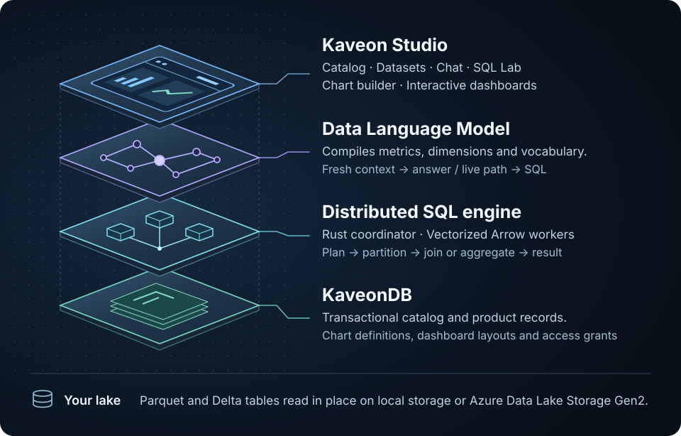

<div align="center">
  <picture>
    <source media="(prefers-color-scheme: dark)" srcset="docs/reference/kaveon-logo-dark.svg">
    
  </picture>
</div>

# Talk to your data

Make every question decision-ready. One governed platform for analytics, dashboards, and deterministic data intelligence. Kaveon Intelligence connects the Data Language Model, Kaveon Engine, and Kaveon Studio: governed context, distributed execution, and a product surface for asking, exploring, and sharing answers.

Kaveon is an open-source analytics platform for data you own. Define what *revenue*, *sessions*, or an *active user* means in a semantic dataset. Use that definition to answer questions in chat, explore your lake in SQL, and publish interactive dashboards.

[Open Studio](https://kaveon.io) · [Run locally](#run-locally) · [Deploy Kaveon](#deploy) · [Documentation](https://kaveon.io/docs)

## Inside Kaveon

[](docs/reference/kaveon-platform-architecture.svg)

The **Data Language Model (DLM)** compiles each dataset’s metrics, dimensions and vocabulary into context it can use to answer supported questions without a hosted language model. A question such as *“Which three countries had the most sessions?”* can use a fresh, precomputed breakdown. When live data is needed, the DLM can generate SQL for the **Kaveon Engine**, whose Rust coordinator and Arrow workers query lake tables in place. **KaveonDB** keeps the definitions, saved queries, charts and dashboard layouts as versioned product records.

[Architecture](ARCHITECTURE.md) · [Engine manual](https://kaveon.io/docs/engine) · [CLI guide](docs/guides/engine-cli.md) · [Project status](STATUS.md)

## Run locally

You need Git, Bash and Docker with Compose v2. On Windows, use WSL with Docker integration enabled.

```bash
git clone https://github.com/PruthviProdduturi/Kaveon.git
cd Kaveon
bash scripts/kaveon-up.sh
```

Open [Studio on localhost](http://localhost:3000), choose **SQL Lab**, and run:

```sql
SELECT 1 AS ready;
```

The result is one row with `ready = 1`. [Local quickstart](https://kaveon.io/docs/quickstart)

### Build your first dashboard

1. **Connect a table.** Run `bash scripts/kaveon-up.sh --data /absolute/path/to/warehouse` with a directory containing your Parquet files or Delta tables. Register a local catalog source and a table at its mounted path under `/data`. Verify a few rows in SQL Lab.
2. **Define a dataset.** Choose the table, a metric to measure, and dimensions to group by. For a table with one row per session, for example, use a row count for *sessions* and *country* as a dimension. Generate DLM context to explore that dataset in chat. [Semantic datasets](https://kaveon.io/docs/datasets) · [DLM guide](https://kaveon.io/docs/dlm)
3. **Publish a dashboard.** In Chart Builder, make a bar chart with *country* on the axis and *sessions* as the metric. Save it, add it to a dashboard, and publish. Add another chart on a compatible dimension to explore both with a shared filter. [Chart Builder](https://kaveon.io/docs/charts) · [Dashboards](https://kaveon.io/docs/dashboards)

## Deploy

| Environment | Start here |
| --- | --- |
| **Local machine or Linux VM** | Start with Docker Compose. Configure authentication and HTTPS before sharing a VM installation. [Self-hosting guide](docs/guides/self-hosting.md) |
| **Azure Kubernetes Service** | The guided preview provisions infrastructure and Microsoft Entra sign-in. Install the Engine and Studio/API Helm releases to bring the application online. [Azure installation package](https://github.com/PruthviProdduturi/Kaveon/tree/5513011212006c4e7f22f46ba7f6951fcf2700dd/infra/marketplace) |
| **AWS** | Coming soon. |

## Contribute

The [contributing guide](CONTRIBUTING.md) covers local development and pull requests. For security issues, use the [security reporting policy](SECURITY.md). Kaveon is licensed under the [MIT License](LICENSE).
