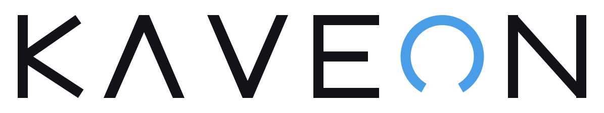
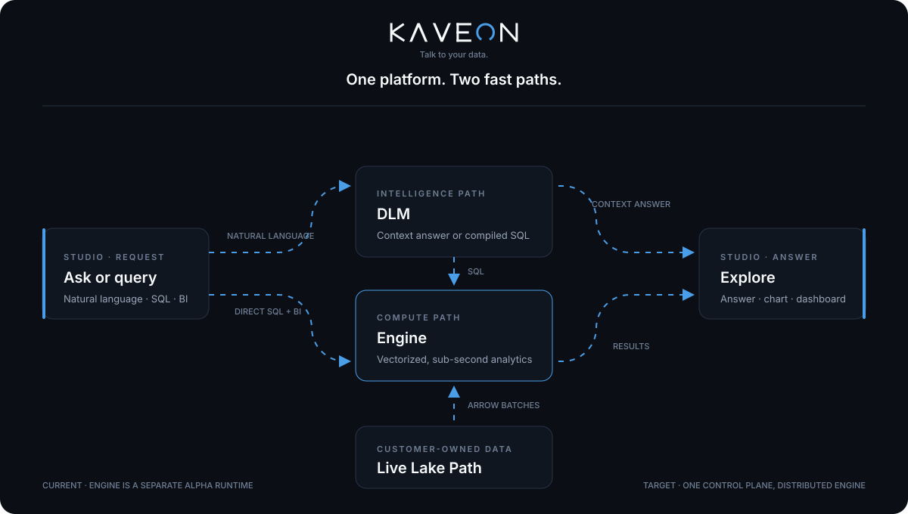
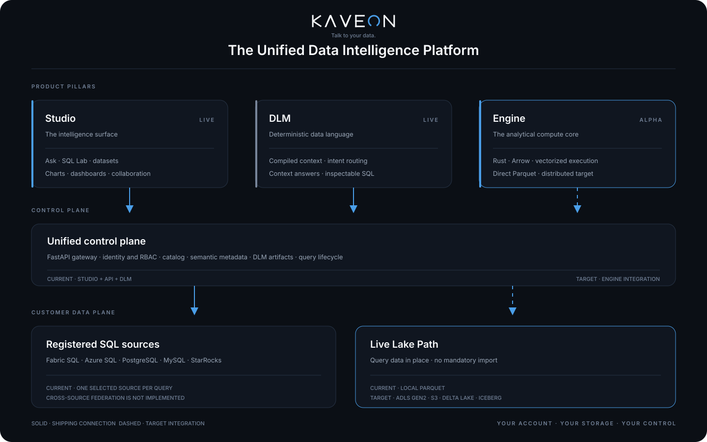

<div align="center">

<picture>
  <source media="(prefers-color-scheme: dark)" srcset="docs/reference/kaveon-logo-dark.svg">
  
</picture>

### One platform to ask, compute, and explore

Kaveon combines a columnar analytical engine, deterministic data intelligence, and a complete BI studio—while keeping data in the systems you own.

[](https://github.com/PruthviProdduturi/Kaveon/actions/workflows/engine.yml)
[](https://github.com/PruthviProdduturi/Kaveon/actions/workflows/ci.yml)
[](LICENSE)
[](https://kaveon.io)

[**Open Kaveon**](https://kaveon.io) · [**Read the docs**](https://kaveon.io/docs) · [**Architecture**](ARCHITECTURE.md) · [**Project status**](STATUS.md)

</div>

<div align="center">
  
</div>

## Three pillars, one system

| Pillar | Responsibility | Current state |
|---|---|---|
| **Kaveon Engine** | Vectorized Rust query engine over Arrow `RecordBatch` data; Parquet, Delta and Iceberg reads from local and ADLS storage, SQL, CLI, HTTP server, and a distributed coordinator/worker runtime | Alpha, and the hosted deployment's only data and control plane |
| **Kaveon DLM** | Deterministic dataset context compilation and natural-language-to-SQL routing without an LLM | Integrated in the Python API |
| **Kaveon Studio** | Next.js analytics experience for questions, SQL, datasets, charts, and dashboards | Live preview |

The product direction is direct lakehouse analytics: read Parquet, Delta Lake, and Iceberg without an import step. The Engine reads Parquet and Delta from local storage and from ADLS Gen2, with checkpoint-aware Delta snapshots and an Iceberg metadata reader; S3 is registerable as a catalog storage type. The hosted deployment runs entirely this way — a billion-row Delta table on ADLS, read distributed across three workers, with no warehouse underneath it.

The control plane runs on the Engine too. Datasets, charts, dashboards, saved queries, favourites and query history are product records committed through the Engine's transaction API to object storage, not rows in a relational database. PostgreSQL has been retired from the deployment.

## Why Kaveon

- **One intelligence surface.** Ask a question, inspect the generated SQL, explore the result, and publish a dashboard without changing products.
- **Deterministic by design.** The DLM compiles dataset metadata and value context, then follows inspectable rules rather than probabilistic token generation.
- **Data stays yours.** Kaveon reads customer-owned lakehouse storage directly — Parquet, Delta and Iceberg on local disk or ADLS Gen2 — and can also query registered databases. There is no import step and no copy held in a Kaveon-owned warehouse.
- **Engine and platform modes.** Run the Rust Engine as a standalone analytical database, or pair it with DLM and Studio for the full experience.
- **Honest maturity.** Implemented, experimental, and target capabilities are separated in [STATUS.md](STATUS.md) and [ARCHITECTURE.md](ARCHITECTURE.md).

The deterministic DLM path requires no LLM. Kaveon's optional AI-assistant features can use configured hosted models; those are separate from DLM routing.

## How a question becomes an answer

```text
Question or SQL
      │
      ├── natural language ──► DLM context resolution ──► context answer or SQL
      │
      └── SQL ───────────────────────────────────────────────────────┘
                                                                       │
                                      registered source or Kaveon Engine
                                                                       │
                                               result rows / Arrow batches
                                                                       │
                                             answer, chart, or dashboard
```

The shipping web path is Studio → same-origin Next.js proxy → FastAPI/DLM → one selected registered SQL source. The Rust Engine currently has separate CLI and HTTP entry points; integrating it as the platform execution backend is target architecture.

## Engine quick start

Requires a current stable Rust toolchain.

```bash
cd engine
cargo run -p kaveon-cli -- --data-dir /path/to/parquet
```

Then query a file by its table name:

```sql
SELECT region, SUM(revenue)
FROM sales
GROUP BY region;
```

Run the Engine quality gates:

```bash
cd engine
cargo fmt --all -- --check
cargo clippy --workspace --all-targets -- -D warnings
cargo test --workspace
```

The root Docker Compose stack starts Studio, the API and DLM, PostgreSQL metadata and data databases, and the Engine coordinator plus two workers:

```powershell
docker compose up -d --build
```

Open Studio at `http://localhost:3000`, the API at `http://localhost:8082`, and the Engine UI at `http://localhost:8081/ui`. All published ports bind to localhost. The stack uses an explicit development identity and local-only secrets; it is not a production deployment configuration. The Engine coordinator distributes eligible single-source partial aggregates across its two workers; joins, shuffle, retries, and fault-tolerant execution are not implemented. Use `docker compose down` to stop it; add `--volumes` only when you intentionally want to delete the local PostgreSQL state. The step-by-step install, including the local 504M-row lake and its catalog registration, is in the [local stack guide](docs/guides/local-stack.md).

For a standalone KaveonDB and Engine install with no metadata service, run
`./scripts/kavedb.sh build` or `./scripts/kavedb.ps1 -Build`. It binds the
local Engine to `http://localhost:8080`, persists the KaveonDB catalog in a
named Docker volume, and is ready for the CLI. See the [local KaveonDB guide](docs/guides/local-kavedb.md).

## Platform quick start

Requires Node.js 22, pnpm, and Python 3.11. Copy `.env.example` to `.env` and configure the required connections first.

```bash
git clone https://github.com/PruthviProdduturi/Kaveon.git
cd Kaveon

pnpm install
pnpm --filter kaveon-studio dev

cd api
pip install -r requirements.txt
python main.py
```

Studio runs on `http://localhost:3000`; the API defaults to `http://localhost:8080`. See [DEPLOYMENT.md](DEPLOYMENT.md) for production topology and configuration.

The public demo runs with the demo posture on: the platform is read-only below the Admin role and the Engine allows each person five live reads per rolling six hours (answers from context and the result cache do not count). Both switches — `KAVEON_DEMO_MODE` on the API, `demo.enabled` in the Engine's resource groups — are off by default, so a self-hosted install has neither; see [Engine settings](docs/engine/settings.md#the-demo-posture).

## Architecture at a glance

<div align="center">
  
</div>

- [Full platform architecture](ARCHITECTURE.md)
- [Engine execution pipeline](docs/reference/kaveon-engine-pipeline.svg)
- [Deployment topology](docs/reference/kaveon-deployment-topology.svg)
- [Azure Engine deployment and connection guide](docs/engineering/azure-deployment-guide.md)
- [DLM flow](docs/reference/kaveon-dlm-flow.svg)

## Current compatibility

| Data system | Current path | State |
|---|---|---|
| Local Parquet | Kaveon Engine direct read | Implemented |
| Local Delta Lake | Kaveon Engine snapshot read, checkpoint-aware | Implemented |
| Parquet and Delta on ADLS Gen2 | Kaveon Engine direct read | Implemented, in production use |
| Iceberg | Kaveon Engine metadata and snapshot reader | Implemented |
| S3 | Registerable catalog storage type | Registerable; not exercised in the hosted deployment |
| Microsoft Fabric SQL / Azure SQL | Studio + API connector | Available |
| MySQL | API connector; not exposed in Studio's source-type picker | Available through API |
| StarRocks | Studio + API connector (MySQL protocol) | Available |
| PostgreSQL | Studio + API connector | Available as a source; retired as Kaveon's own store |
| Trino | No executable driver | Planned |

Each platform query targets one selected data source; cross-source federated execution is not implemented.

The Engine remains **alpha** as a database: the SQL surface is incomplete against Trino, and the qualification evidence under [`docs/qualification/`](docs/qualification/) is the authority on what has actually been measured rather than this table.

## Repository map

```text
Kaveon/
├── engine/       Rust analytical engine, server, CLI, Python binding, and benchmarks
├── studio/       Next.js 15 / React 19 intelligence and BI surface
├── api/          FastAPI platform API and deterministic DLM
├── packages/     Shared TypeScript packages
├── infra/        Azure infrastructure as code
├── docs/         Guides, architecture references, and technical papers
├── scripts/      Operational and data utilities
└── demo/         Demonstration data tooling
```

## Documentation

| Start and operate | Technical depth |
|---|---|
| [Product architecture](ARCHITECTURE.md) | [DLM white paper](docs/whitepaper-dlm.md) |
| [Current status](STATUS.md) | [DLM curation](docs/whitepaper-dlm-curation.md) |
| [Deployment](DEPLOYMENT.md) | [Adaptive context routing](docs/whitepaper-adaptive-context-routing.md) |
| [Security](SECURITY.md) | [Deterministic NL→SQL](docs/whitepaper-nl-to-sql.md) |
| [Contributing](CONTRIBUTING.md) | [Product strategy](docs/product-strategy.md) |

The complete documentation map, including API and configuration references, is in [docs/README.md](docs/README.md).

## License

Kaveon is available under the [MIT License](LICENSE). MIT permits use, modification, distribution, and commercial use subject to preserving its copyright and license notice; it does not require separate consent.
