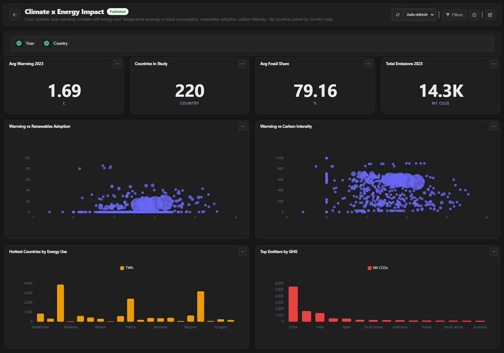

<div align="center">
  <picture>
    <source media="(prefers-color-scheme: dark)" srcset="docs/reference/kaveon-logo-dark.svg">
    
  </picture>
</div>

# Talk to your data

Kaveon is an open-source analytics workspace for data you own. Ask a question in plain English, inspect the SQL behind an answer, or build a dashboard over the same dataset. The distributed Rust engine reads Parquet and Delta tables in place.

[Open Studio](https://kaveon.io) · [Read the docs](https://kaveon.io/docs) · [Run locally](#run-locally)



## Run locally

You need Git, Bash and Docker with Compose v2. On Windows, use WSL with Docker integration enabled.

```bash
git clone https://github.com/PruthviProdduturi/Kaveon.git
cd Kaveon
bash scripts/kaveon-up.sh
```

Open [Studio on localhost](http://localhost:3000), choose **SQL Lab**, and run:

```sql
SELECT 1 AS ready;
```

You should see one row with the value `1`. To query your own files, restart the launcher with `--data /absolute/path/to/warehouse`, then register a table under the mounted `/data` directory. [Local quickstart](https://kaveon.io/docs/quickstart)

## How a question becomes an answer

| Component | What it does |
| --- | --- |
| **Data Language Model (DLM)** | Compiles a dataset’s metrics, dimensions and vocabulary. For supported questions it can answer from precomputed context or generate SQL for live execution. This path uses no hosted model. |
| **Kaveon Engine** | Plans SQL and distributes work across Arrow-based workers. Workers can exchange partitions for joins and grouped aggregates. KaveonDB stores product records such as saved queries, charts and dashboards. |
| **Kaveon Studio** | Gives analysts one workspace for chat, catalog discovery, SQL Lab, charts and dashboards. A team can reuse a metric defined on a dataset across multiple views. |

[Architecture](ARCHITECTURE.md) · [Engine manual](https://kaveon.io/docs/engine) · [CLI guide](docs/guides/engine-cli.md) · [Project status](STATUS.md)

## Deploy

| Environment | Start here |
| --- | --- |
| **Local machine or Linux VM** | Start with Docker Compose. Configure authentication and HTTPS before sharing a VM installation. [Self-hosting guide](docs/guides/self-hosting.md) |
| **Azure Kubernetes Service** | The guided preview provisions infrastructure and Microsoft Entra sign-in. Install the Engine and Studio/API Helm releases to bring the application online. [Azure installation package](https://github.com/PruthviProdduturi/Kaveon/tree/a2c4d3f99f4bf9e49f77726b856a59182e8d29ef/infra/marketplace) |
| **AWS** | Coming soon. |

## Contribute

The [contributing guide](CONTRIBUTING.md) covers local development and pull requests. For security issues, use the [security reporting policy](SECURITY.md). Kaveon is licensed under the [MIT License](LICENSE).
